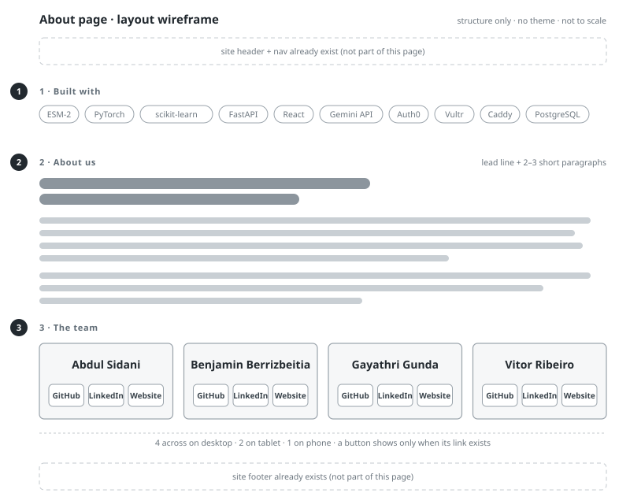

# Prompt: build the AnHydra About page

You are building the **About** page for AnHydra, a web tool that screens protein sequences for
desiccation-protective character. Build only the page body described below. The site around it
(header, logo, navigation, footer) already exists, so do not add or duplicate any of it.

The wireframe (`docs/about-page-layout.svg`) shows structure only. Its greys are placeholders,
not colours to use.

## Theme

Do **not** define a theme. Add no colours, fonts, font sizes, radii, shadows or CSS variables of
your own. Use the design tokens and existing components (cards, buttons, chips, headings, icons) that the
site already defines, so the page matches the rest of AnHydra and follows any theme change
automatically. Any new CSS should be layout only (grid, gaps, wrapping), expressed in the site's
existing spacing tokens.

## Page body, in this order

### 1. Built with

A heading and a row of chips that wraps on narrow screens:

ESM-2 · PyTorch · scikit-learn · FastAPI · React · Gemini API · Auth0 · Vultr · Caddy · PostgreSQL

### 2. About us

A heading, one lead line, then two short paragraphs. Use this copy:

> **Lead:** An animal smaller than a grain of sand can lose almost all its water and come back to
> life. We wanted to know which proteins make that possible.
>
> Tardigrades survive drying out with the help of a few protein families: CAHS proteins in
> tardigrades, and LEA proteins and dehydrins in plants. Finding more proteins like them could
> help vaccines, medicines and crops survive without refrigeration. AnHydra is a first-pass
> filter: paste a sequence, see whether it looks like one of the protective families, and see why.
>
> Our model scored 0.987 on the test we designed to be hard. Instead of celebrating, we went
> looking for the catch and found it: our negative examples made the task easier than it looked.
> We rebuilt the data and reported the honest number.

### 3. The team

A heading and four cards in a responsive grid: four across on desktop, two on tablet, one on
phone. Each card has **only**:

- the member's **name**, and
- a row of up to three **icon widgets**: GitHub, LinkedIn, Website.

No photos, roles, bios or descriptions.

Icon widgets:

- Icons only, no visible text labels.
- Use the GitHub mark, the LinkedIn "in" mark and a globe for the website. If the site already
  has an icon set, take them from it; otherwise use inline SVGs.
- Icons take their colour from the surrounding text (`currentColor`) so they follow the theme.
  Hover and focus states come from the site's existing button styles.
- Each widget is a link with an accessible name that includes the person, for example
  `aria-label="Abdul Sidani on GitHub"`, plus a matching tooltip (`title`).
- Render a widget only when its URL exists.
- Links open in a new tab with `rel="noopener noreferrer"`.
- Make each widget a comfortable tap target on phones (about 44 × 44 px), sized with the site's
  existing spacing tokens.

Keep the member data in one list so content edits never touch markup:

| Name | GitHub | LinkedIn | Website |
| --- | --- | --- | --- |
| Abdul Sidani | https://github.com/abdulksidani-png | _TBD_ | _TBD_ |
| Benjamin Berrizbeitia | https://github.com/Benberrizb | _TBD_ | _TBD_ |
| Gayathri Gunda | https://github.com/Gayathri-Gunda | _TBD_ | _TBD_ |
| Vitor Ribeiro | _TBD_ | _TBD_ | _TBD_ |

Leave _TBD_ entries empty in the data (those widgets simply won't render). Do not invent URLs.

## Requirements

- The page is public: readable without signing in.
- Page title: "About us — AnHydra".
- No horizontal scroll at phone width; chips and cards wrap.
- Visible keyboard focus on every link and button.

## Done when

- The three sections render in the order above, inside the site's existing header and footer.
- `git diff` adds no colour values, font declarations or new CSS variables.
- The layout has been checked at phone, tablet and desktop widths.
- The project's existing tests and build pass.
